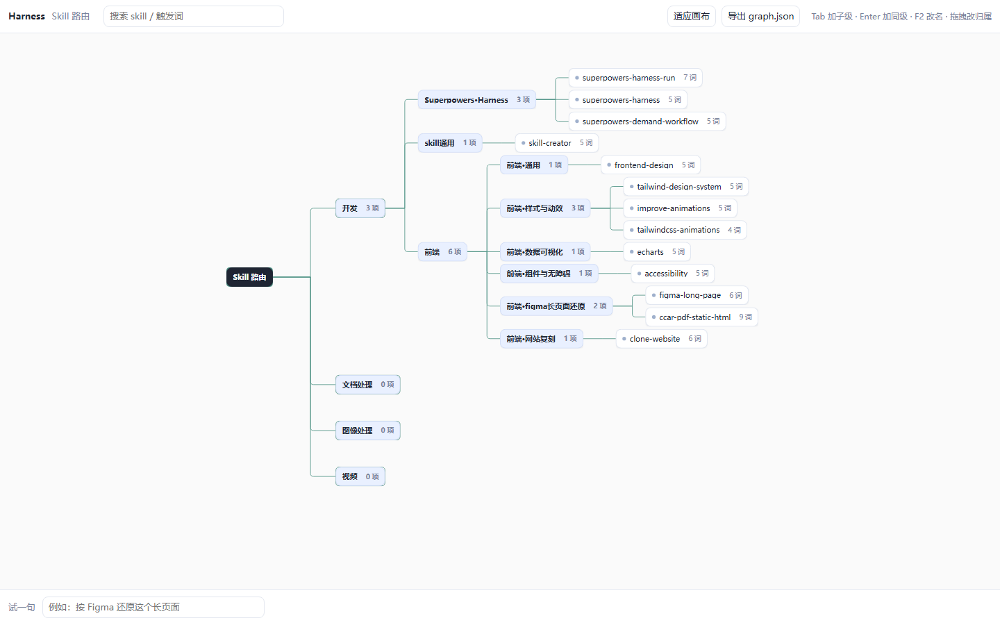

# Skill 路由面板（v2 · 成熟库版）

用 [simple-mind-map](https://github.com/wanglin2/mind-map)（MIT）做画布。它不是"画图库"，而是一套完整的 XMind 式交互内核：Tab/Enter 建节点、F2 改名、拖拽换父级、框选、撤销重做、缩放平移、搜索，全部内置。

第一版手写 SVG 画布的问题就是"交互层要自己造"，这一版直接换掉。



## 跑起来

```bash
cd harness-v2/panel
npm install
npm run dev        # http://localhost:5180
```

已构建过一份静态产物：`dist/`（`base: './'`，可放任意静态服务器）。改了代码要重新 `npm run build`。

## 现在能做什么

| 交互 | 说明 |
|---|---|
| **建节点** | 选中后 `Tab` 加子级、`Enter` 加同级（和 XMind 一致） |
| **改名** | `F2` 或双击节点，就地输入，回车确认 |
| **删除** | `Delete` |
| **换归属** | 拖住节点拖到目标节点上 |
| **撤销/重做** | `Ctrl+Z` / `Ctrl+Shift+Z` |
| **缩放平移** | 滚轮缩放、拖空白平移、`适应画布` 一键回到全览 |
| **搜索** | 顶部输入后回车，命中节点高亮（Search 插件）；也支持 `?q=figma` 直接带词打开 |
| **属性编辑** | 点节点 → 右侧抽屉：改描述、加/删触发词 |
| **试一句** | 底部输入任务描述 → 列出命中的 skill 和原因；点结果跳到对应节点 |
| **导出** | `导出 graph.json`，格式与仓库里的 `routing/graph.json` 一致 |

节点上直接显示两类信息：分类的**子项数**、skill 的**触发词数**；触发词重复时显示红色 `⚠n`。

## 结构

```
panel/
├── index.html
├── vite.config.js
└── src/
    ├── main.js       画布初始化、自定义节点、抽屉、试一句
    ├── data.js       graph.json → 思维导图树；树 → graph.json（导出）
    ├── graph.json    当前 13 个 skill 的真实数据
    └── style.css     节点/抽屉/底部栏样式
```

## 接入要点（踩过的坑）

插件不是构造参数，是实例方法：

```js
import Drag from 'simple-mind-map/src/plugins/Drag.js'
import Search from 'simple-mind-map/src/plugins/Search.js'

const mindMap = new MindMap({ ... })
mindMap.addPlugin(Drag)     // 少了这行：拖拽不生效
mindMap.addPlugin(Search)   // 少了这行：mindMap.search undefined
```

页面会写 `data-search` / `data-drag` 两个属性，都是 `ok` 才算插件挂上。

## 还没做

- **右键菜单**：新建/删除/复制/移动（库是事件式的，需要自己提供菜单 UI）
- **关联线**：冲突和依赖画成可见的线（`AssociativeLine` 插件已随包提供，还没接）
- **保存到服务器**：现在只有导出；下一步接 `/api/save` → git commit
- **大模型**：选中节点 → 生成触发词 / 查冲突
- **权限**：上线前至少要加一层 Basic Auth

## 和上一版原型的区别

`harness-v2/prototype/` 是手写 SVG 版，保留作对照。对比下来结论很清楚：**交互内核不要自己写**，用库；我们把精力放在"数据模型、校验、保存、AI"上。
